# Supplementary Material for “Source-Level Reliability Estimation under Publisher-Disjoint Evaluation”

*This supplementary material accompanies the main manuscript submitted to ECIR 2027, “IR for Good” track.*

*It reports in full the error and bias audit behind the main paper's conditions for responsible use, together with the experimental detail needed to reproduce them.*

---

## 1. Model performance

Figure 1 shows the confusion matrices for each fold and for the average.

| | |
|:--:|:--:|
| 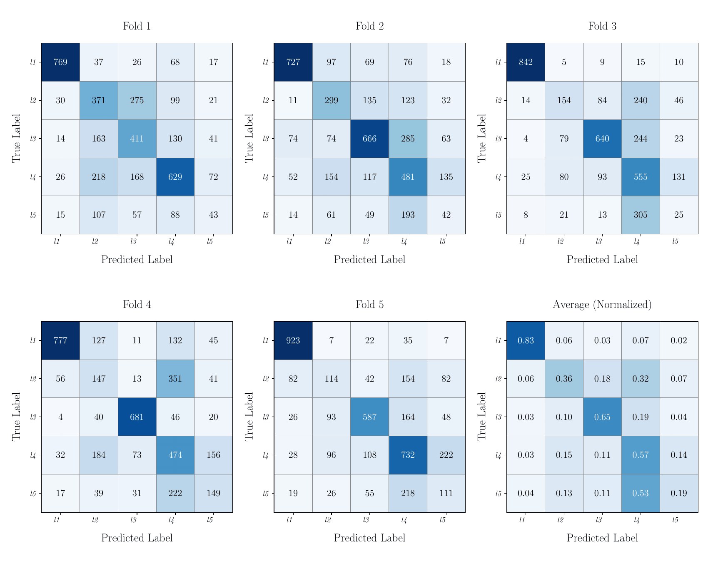 | 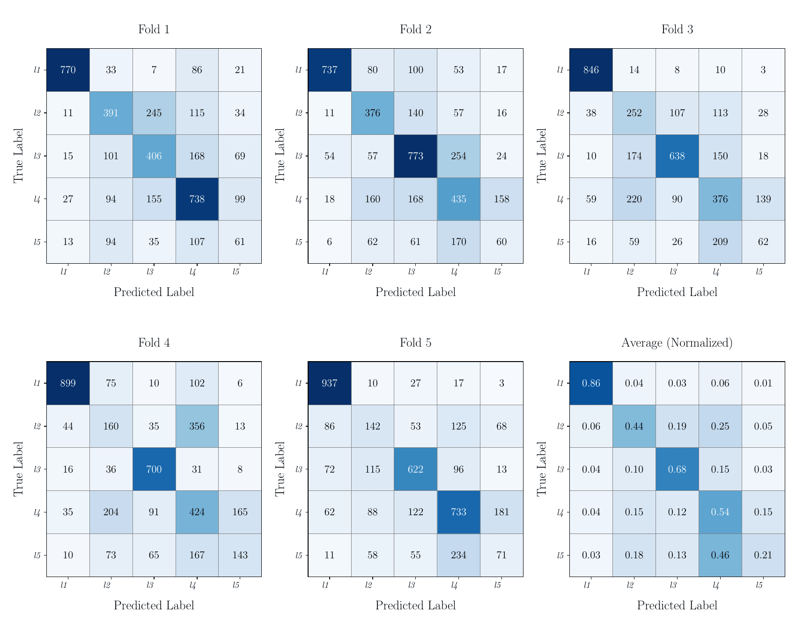 |
| **(a)** BERT | **(b)** RoBERTa |
| 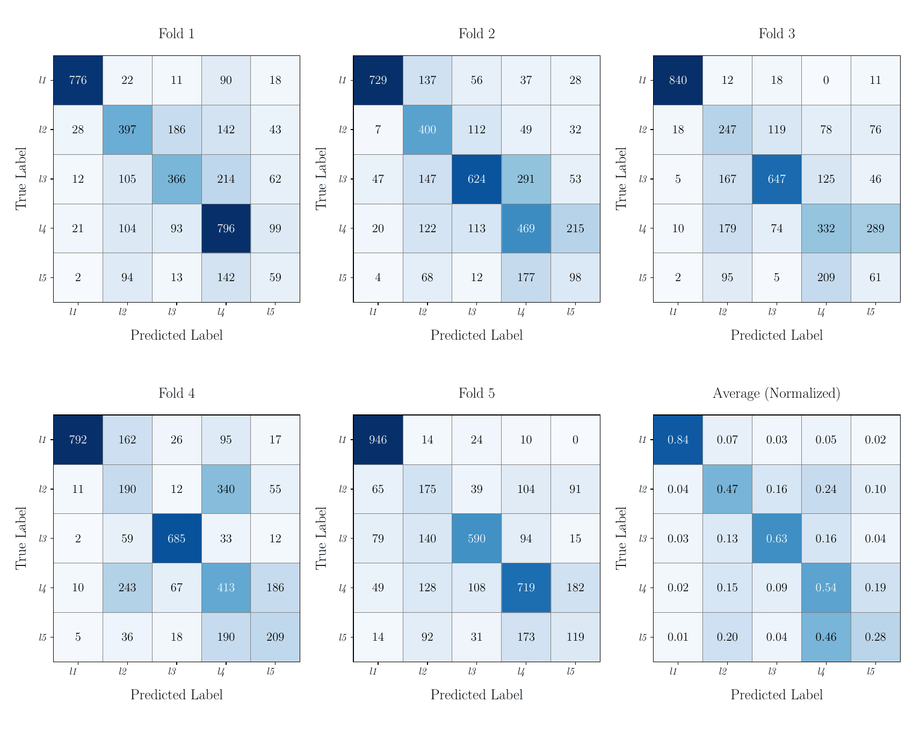 | 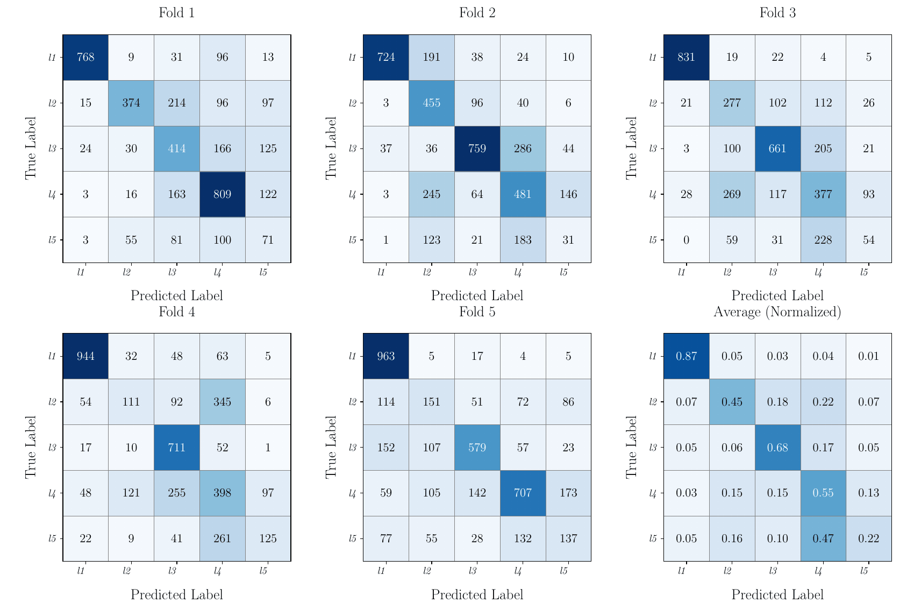 |
| **(c)** Llama 3 | **(d)** Mistral |

**Figure 1.** Confusion matrices showing the models' performance across five cross-validation folds and their overall average. The rows correspond to the true labels and the columns to the predicted ones.

---

## 2. Publisher-level Results

Figure 2 reports the publisher-level confusion matrices obtained after aggregating article-level predictions by majority voting.

| | |
|:--:|:--:|
| 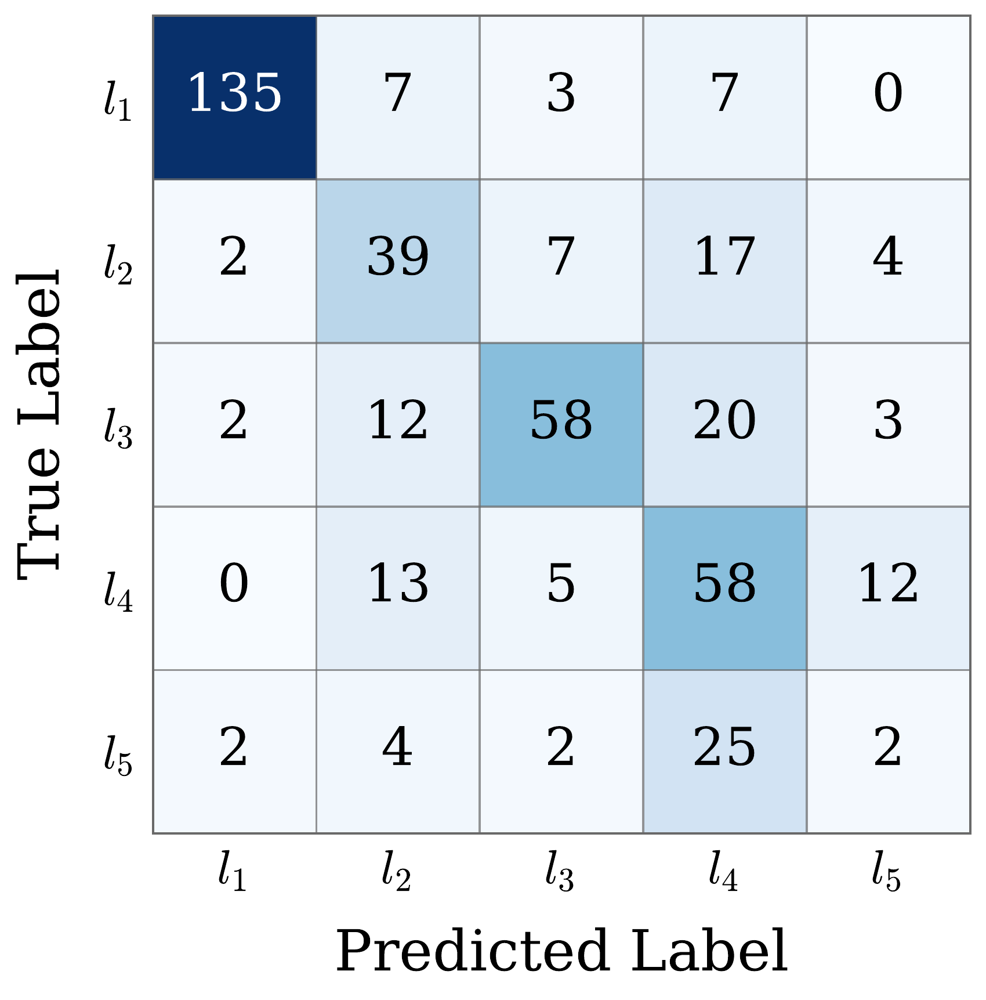 | 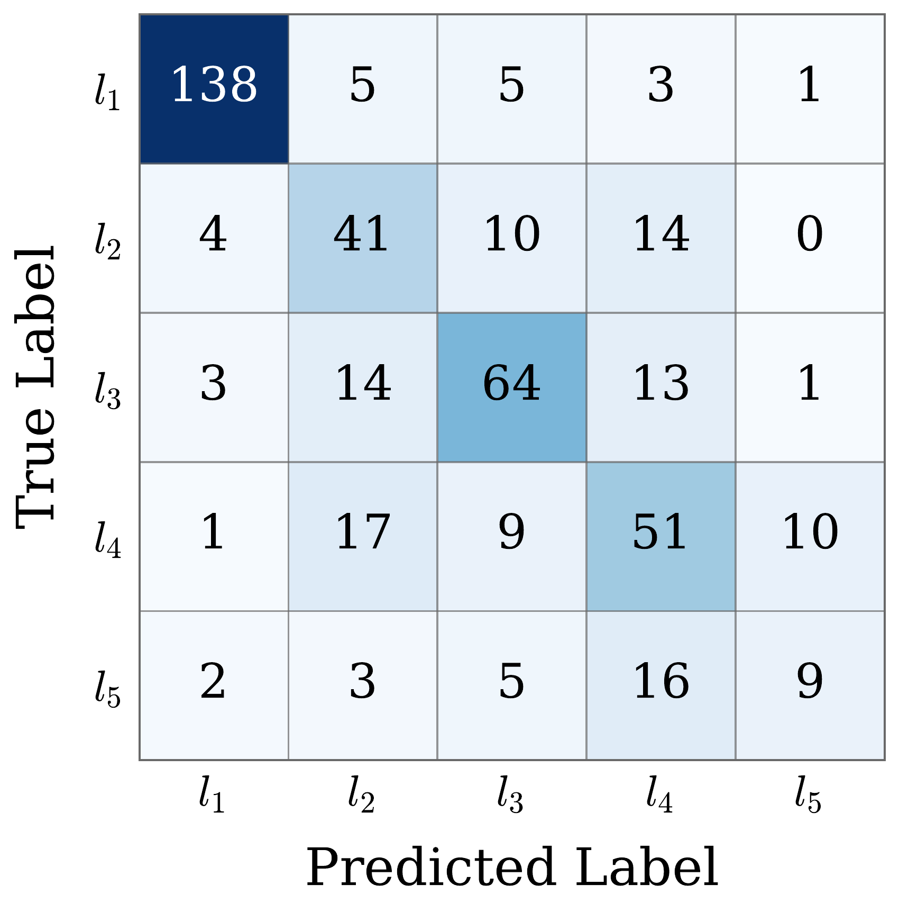 |
| **(a)** BERT | **(b)** RoBERTa |
| 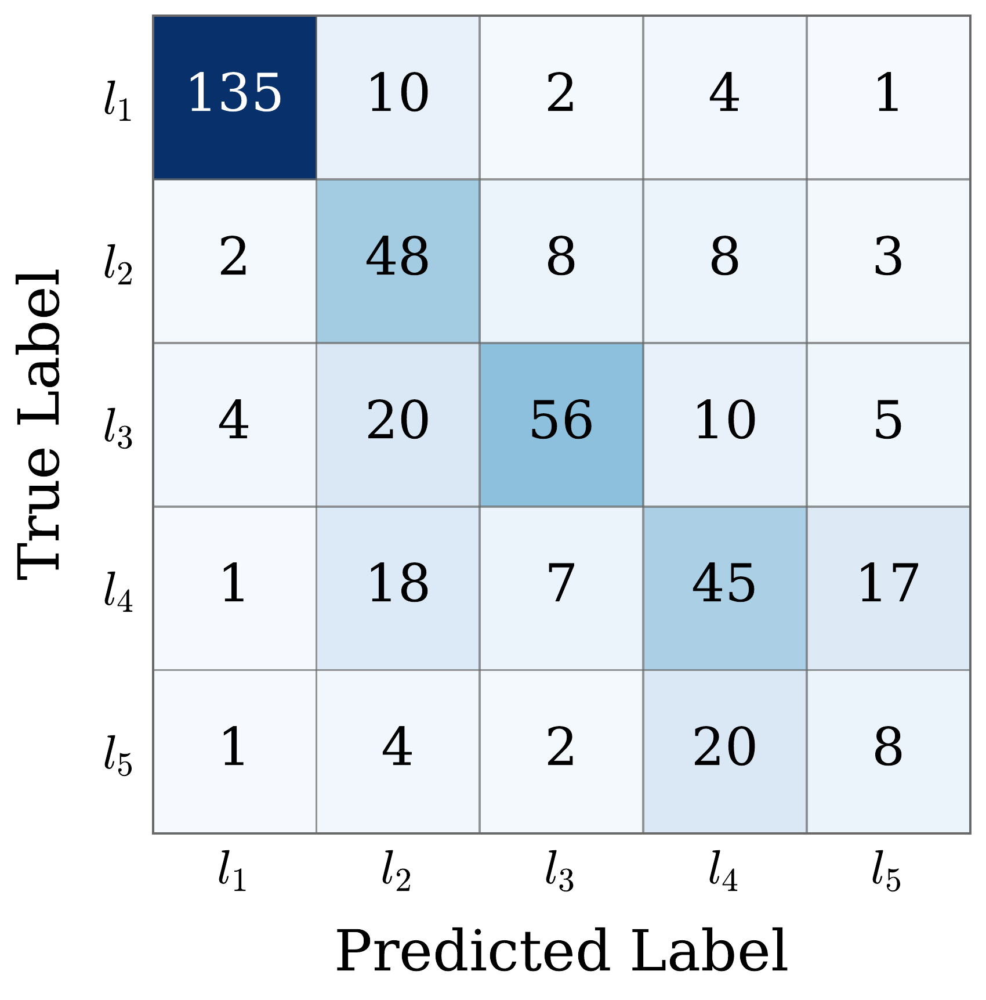 | 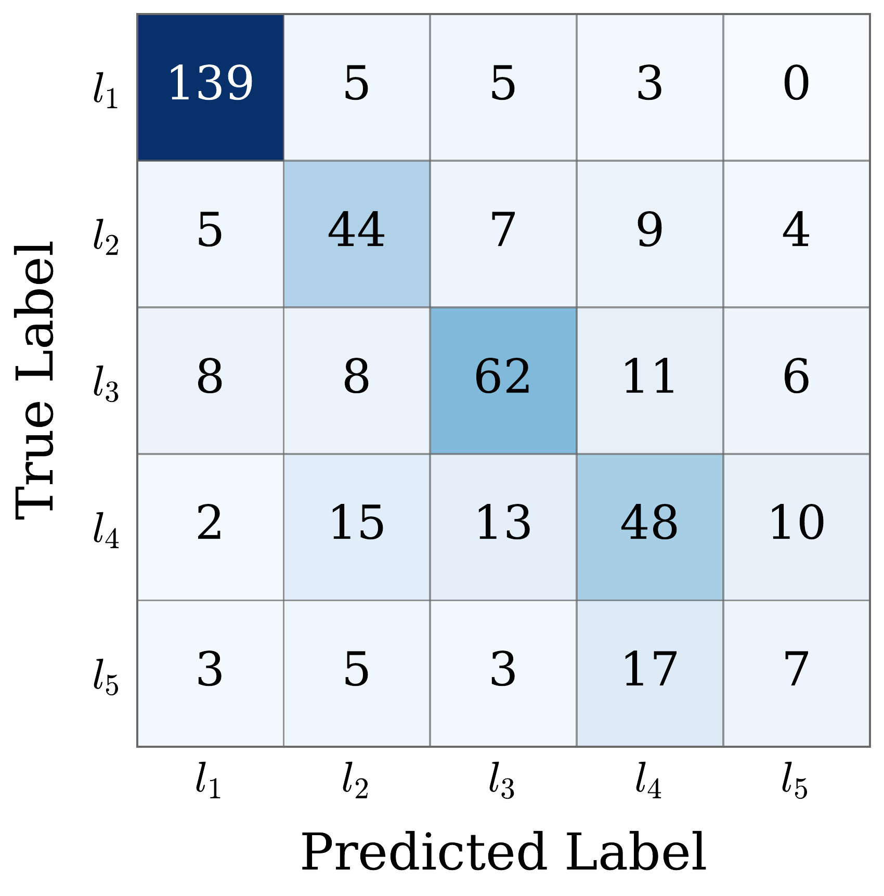 |
| **(c)** Llama 3 | **(d)** Mistral |

**Figure 2.** Publisher-level confusion matrices for BERT, RoBERTa, Llama 3, and Mistral. Rows indicate true reliability levels, columns indicate predicted levels.

The matrices reveal that errors are strictly local. The most frequent confusion occurs between l₄ (Generally Credible) and l₅ (High Credibility). As observed at the article level, distinguishing l₅ from l₄ is inherently difficult because l₅ represents a strict ceiling (score = 100) while l₄ covers the immediately lower high-credibility range (75–99). Misclassifying these two adjacent levels constitutes a minor severity error, as both indicate high reliability. No model exhibits systematic confusion across non-adjacent levels, confirming that aggregation stabilizes predictions.

One caveat applies to every publisher-level number reported here and in the main paper. Aggregation is a majority vote, and ties are resolved deterministically in favour of the *lowest* reliability level. This affects a small but non-negligible share of publishers — 13 of 439 for BERT, 20 for RoBERTa, 15 for Llama 3 and 11 for Mistral — and always in the same direction, so it is a mild systematic pull toward lower predicted reliability rather than a neutral rule.

---

## 3. Political leaning

| | |
|:--:|:--:|
| 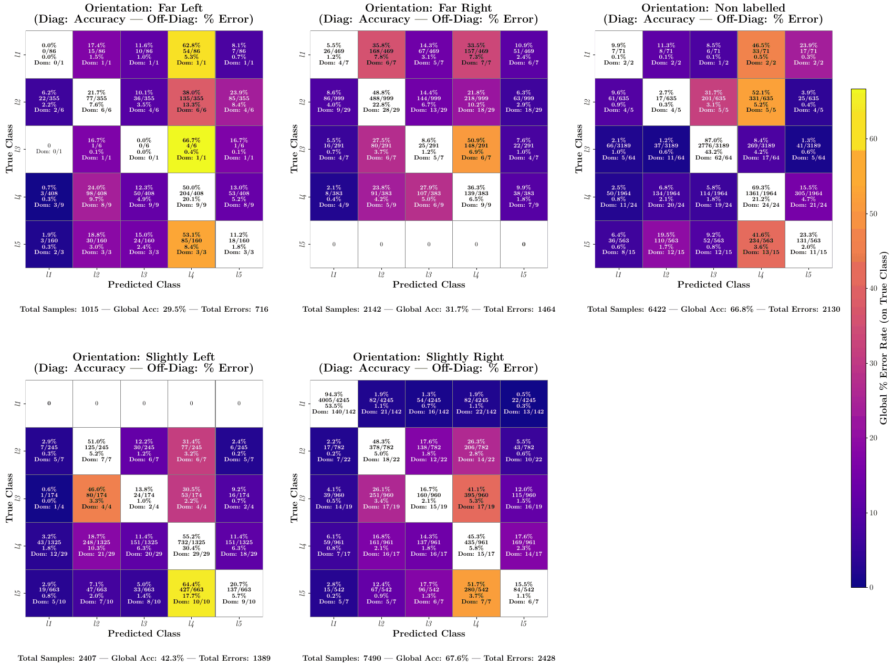 | 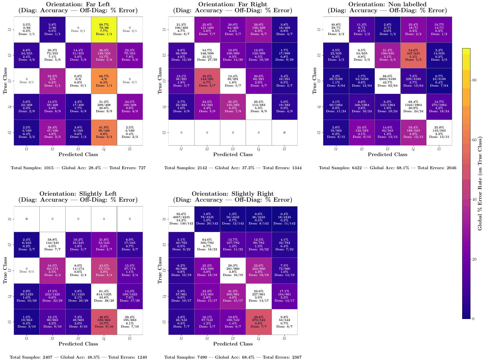 |
| **(a)** BERT | **(b)** RoBERTa |
| 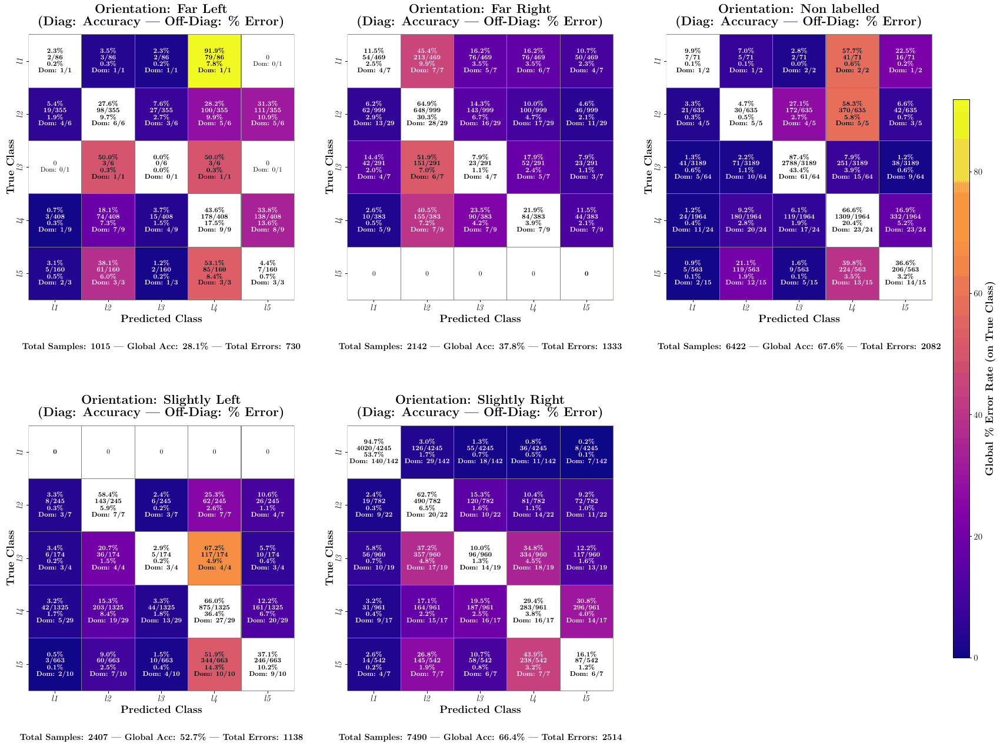 | 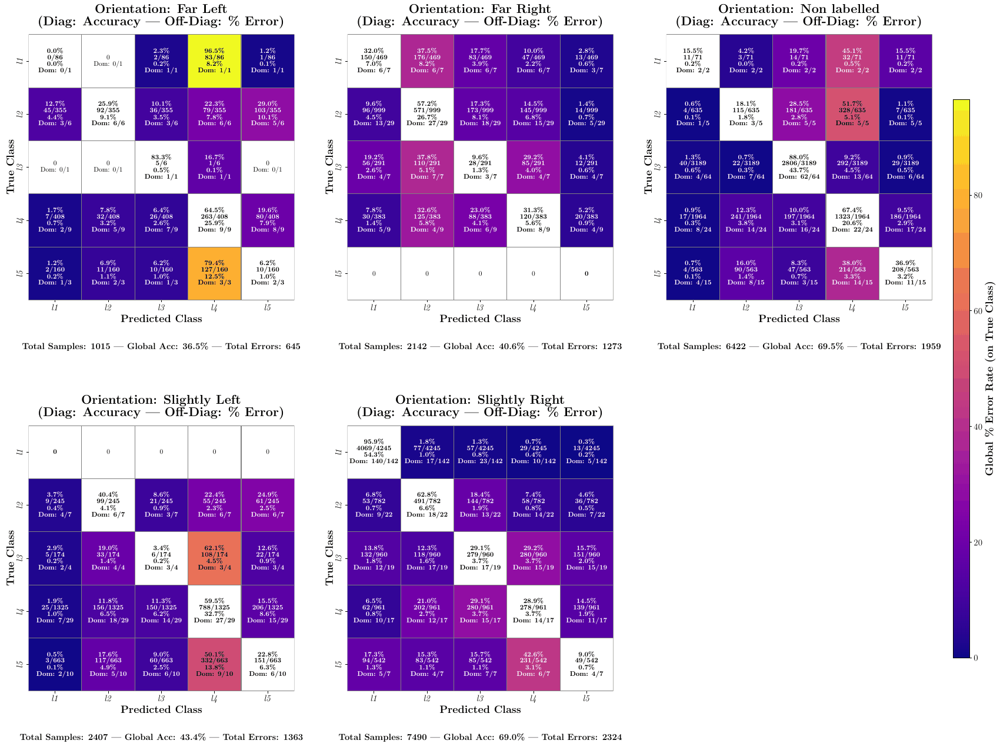 |
| **(c)** Llama 3 | **(d)** Mistral |

**Figure 3.** Confusion matrices for political orientation across the four models. The rows correspond to the true labels and the columns to the predicted ones. The cells show class-wise percentages and counts, dataset-level percentages and contributing domains, and the colour represents the error rate per true class.

Figure 3 reveals why the Chi-square test rejects the hypothesis of independence: the distribution of errors varies between moderate and extreme political groups, with notable differences across models. The matrices for ‘Slightly Right’ and ‘Non-labelled’ orientations exhibit strong diagonal dominance across all architectures. For the former (the largest group, *N* = 7490), Mistral, RoBERTa, and BERT achieve comparable accuracies of 69.0%, 68.4%, and 67.6%, respectively, with Llama 3 at 66.4%. The domain counts (annotated as ‘Dom’ in the cells) show that this performance is robust across a large number of unique sources.

In contrast, the ‘Far Left’ (*N* = 1015) and ‘Far Right’ (*N* = 2142) matrices display high off-diagonal scattering and significantly lower global accuracy. For ‘Far Left’, all models perform poorly with accuracies between 28.1% and 29.5% for the three smaller models and 36.5% for Mistral. Visual inspection confirms a systematic directional bias: predictions frequently land in the upper triangle of the matrix, confirming that models overestimate the reliability of these sources.

The ‘Far Right’ category shows the greatest difference between the models. Mistral, Llama 3, and RoBERTa achieved 40.6%, 37.8%, and 37.3%, respectively, while BERT dropped to 31.7%.

Domain metrics further clarify that errors in these extreme categories are driven by a small set of outlets. Unlike the diverse ‘Slightly Right’ group, the ‘Far Left’ and ‘Far Right’ categories contain fewer unique domains e.g., *Dom: 1/1* or *Dom: 5/7*, yet these specific outlets consistently trigger model errors. The ‘Slightly Left’ matrix confirms the specific discrediting pattern discussed in the main manuscript, where models tend to underestimate the reliability of slightly left-leaning sources. A substantial cluster of misclassifications appears in the lower triangle, below the diagonal. This visually demonstrates that models penalize these articles, assigning them lower reliability labels compared to the ground truth, a behavior consistent across all four architectures.

We stress that these matrices are descriptive. Because political leaning and reliability are both properties of the publisher, and are themselves associated in the media ecosystem, the per-leaning error rates visible here cannot on their own separate a political effect from a reliability effect. The main paper addresses this with publisher-clustered tests that control for the true reliability level.

---

## 4. Error Direction at the Article Level

The main paper reports the per-class error rate; here we report the companion analysis of the *direction* of those errors, measured by the Mean Error Direction (MED), the average signed difference between predicted and true reliability labels over misclassified instances. Positive values indicate overestimation of reliability, negative values underestimation.

Figure 4 plots the Mean Error Direction (MED) to quantify the prediction bias. MED is defined as the average signed difference between predicted and true reliability labels over misclassified instances. We observe a tendency to regress towards the center. We attribute this to two structural factors:

- **Boundary Constraints (l₁ and l₅).** Errors at the extremes are naturally constrained: models can only overestimate l₁ and underestimate l₅. However, the significant negative MED in l₅, ≈ −1.30 (BERT −1.29, RoBERTa −1.37, Llama −1.20, Mistral −1.36). The confusion matrices reveal that the vast majority of misclassifications for l₅ are concentrated in adjacent l₄ (Section 1). This confirms that the high error rate is primarily due to the models struggling to distinguish between perfect (100) and generally credible (75–99) reliability, likely because there is little textual distinction between these high-standard categories. The fact that the MED is slightly below −1.0 indicates a minor tendency to misclassify some l₅ instances into lower tiers (levels 2 and 3), but the main misclassification consists of labeling l₅ as l₄.

- **The ‘Safe Harbor’ Effect (l₃).** Class l₃ shows a Mean Error Direction close to zero (0.03 to 0.12 across models, with Mistral at 0.10). l₃ acts as a gravitational center for uncertainty: it absorbs a significant portion of misclassifications from the lower-reliability l₂ and from the higher-reliability l₄. Since the model overestimates l₂ (pushing it up to 3) and underestimates l₄ (pushing it down to 3), these opposing error vectors cancel each other out, resulting in a net directional bias of zero.

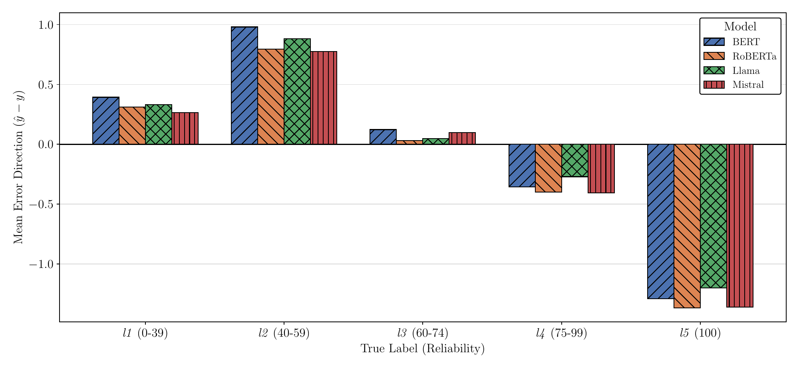

**Figure 4.** Mean Error Direction by true reliability level. Positive values indicate overestimation of reliability, negative values underestimation.

---

## 5. Political Leaning: Distribution and Error Rates

The main paper reports the directional bias by political leaning and the associated significance tests, and it makes the disclosure of per-leaning error rates a condition for responsible deployment. Figure 5 gives the composition of the corpus, and the per-leaning error rates behind those tests. Readers can therefore inspect the disparity rather than take it on trust.

The distribution is markedly imbalanced: reliability levels are not uniformly represented within each political category, which is a structural property of the media ecosystem rather than of our sampling. This is why error rates are computed class-conditionally in the main paper, making them independent of category frequency. Mistral deviates from the other three models, showing fewer errors in the extreme categories and a higher error rate on Slightly Left, while performing comparably on Non labelled and Slightly Right.

| | |
|:--:|:--:|
| 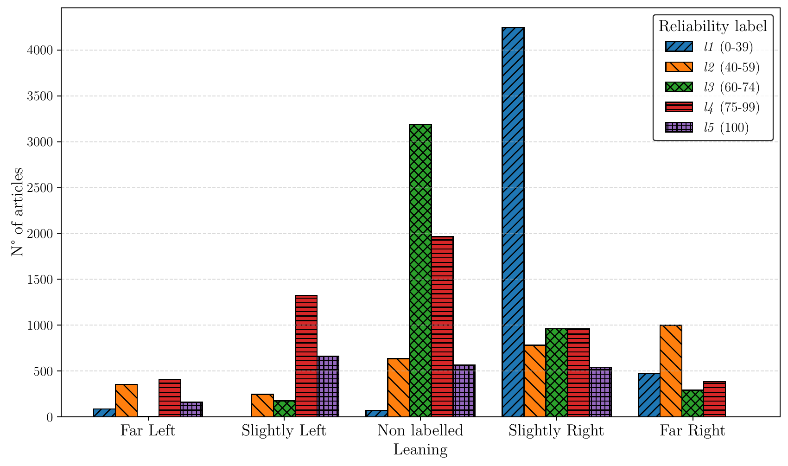 | 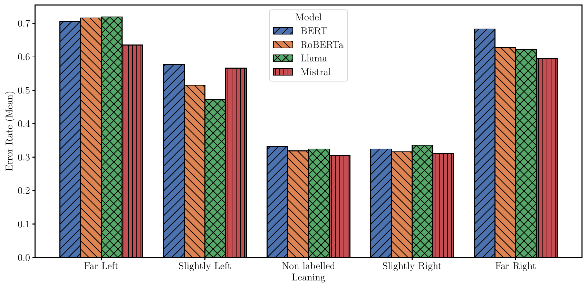 |
| **(a)** Reliability labels across political leanings. | **(b)** Error rate by leaning and model. |

**Figure 5.** Composition of the corpus by political leaning (left) and the resulting per-leaning error rates (right).

---

## 6. Robustness of the Bias and Performance Analyses

The main paper reports tests that treat each article as an independent observation. Political leaning and reliability are publisher-level attributes, and every article of an outlet carries the same value. This section therefore repeats the analyses at the unit on which the labels actually live.

### Independence at the publisher unit

Table 1 repeats the χ² test of independence with one observation per publisher: was the aggregated prediction for that outlet correct? The 439 publishers replace the 77,904 articles, and no expected count falls below five. The association between political leaning and correctness survives for every model, and the effect size is larger than at the article level.

| Model | *n* | χ² | *p*-value | Cramér's V |
|:--|--:|--:|--:|--:|
| BERT | 439 | 44.84 | 4.3 × 10⁻⁹ | 0.320 |
| RoBERTa | 439 | 18.83 | 8.5 × 10⁻⁴ | 0.207 |
| Llama 3 | 439 | 23.88 | 8.4 × 10⁻⁵ | 0.233 |
| Mistral | 439 | 24.06 | 7.8 × 10⁻⁵ | 0.234 |

**Table 1.** Political leaning vs. classification correctness at the publisher unit, 4 degrees of freedom. Compare with the article-level table of the main paper.

### Leaning or reliability?

Reliability levels are unevenly distributed across political leanings, and some levels are harder than others. An apparent political effect could therefore be a reliability effect in political guise. For each model we fit a logistic regression of the article-level error indicator on political leaning, we enter the true reliability level as a control, and we cluster the standard errors on the publisher. Table 2 reports the result against the non-labelled reference group. Far-left and far-right outlets keep four to six and a half times the odds of error of non-labelled ones, with the reliability level already accounted for.

| Leaning | BERT | RoBERTa | Llama 3 | Mistral |
|:--|:--:|:--:|:--:|:--:|
| Far Left | 4.81\*\* | 5.55\*\* | 6.29\*\* | 4.00\* |
| Slightly Left | 2.11\* | 1.49 | 1.41 | 2.12 |
| Slightly Right | 2.11\* | 2.46\* | 2.74\* | 2.56\* |
| Far Right | 6.52\*\*\* | 6.18\*\* | 6.29\*\* | 5.57\*\* |

**Table 2.** Odds ratios of misclassification by political leaning, relative to the non-labelled group, from a logistic regression controlling for the true reliability level with publisher-clustered standard errors. \**p* < 0.05, \*\**p* < 0.01, \*\*\**p* < 0.001.

### Uncertainty on the publisher-level scores

Table 3 reports 95% percentile intervals from a *cluster* bootstrap, which resamples whole publishers rather than individual articles. The intervals of the four models overlap on both metrics. At this sample size the differences between them, 0.69 against 0.68 on accuracy, are not distinguishable from sampling variation.

| Model | Accuracy [95% CI] | Tolerant acc. α = 1.0 [95% CI] |
|:--|:--:|:--:|
| BERT | 0.665 [0.617, 0.708] | 0.870 [0.838, 0.900] |
| RoBERTa | 0.690 [0.647, 0.731] | 0.875 [0.843, 0.904] |
| Llama 3 | 0.665 [0.620, 0.708] | 0.879 [0.847, 0.907] |
| Mistral | 0.683 [0.642, 0.727] | 0.856 [0.822, 0.888] |

**Table 3.** Publisher-level metrics with cluster-bootstrap confidence intervals (2,000 resamples of the 439 publishers).

### Leaning and reliability are entangled in the corpus

The regression above controls for the true reliability level, but the two variables are close to collinear in our data, so no analysis can separate them completely. Table 4 counts the publishers in each combination. Of the 207 slightly right publishers, 142 sit in l₁; no slightly left publisher sits there at all, and no far-right publisher reaches l₅. Several cells hold fewer than ten publishers, and two are empty, so the additive control rests on thin support.

| | Far Left | Sl. Left | Non lab. | Sl. Right | Far Right |
|:--|:--:|:--:|:--:|:--:|:--:|
| l₁ | 1 | — | 2 | 142 | 7 |
| l₂ | 6 | 7 | 5 | 22 | 29 |
| l₃ | 1 | 4 | 64 | 19 | 7 |
| l₄ | 9 | 29 | 24 | 17 | 9 |
| l₅ | 3 | 10 | 15 | 7 | — |
| **Total** | **20** | **50** | **110** | **207** | **52** |

**Table 4.** Publishers by political leaning and true reliability level. A dash marks an empty combination.

Table 5 gives the article-level error rate inside each combination, pooled over the four models. Two cells dominate the corpus and the models get both of them right: the 142 slightly right publishers in l₁ carry a 5% error rate, and the 64 non-labelled publishers in l₃ carry 12%. Every other combination falls between 32% and 99%. The models therefore recognise the two largest blocks of the ground truth, and they do poorly outside them. Cells built on a handful of publishers are noisy, but the composition counts behind them are exact.

| | Far Left | Sl. Left | Non lab. | Sl. Right | Far Right |
|:--|:--:|:--:|:--:|:--:|:--:|
| l₁ | 99 | — | 81 | **5** | 82 |
| l₂ | 76 | 48 | 91 | 40 | 44 |
| l₃ | 79 | 93 | **12** | 79 | 90 |
| l₄ | 48 | 39 | 32 | 68 | 70 |
| l₅ | 94 | 73 | 69 | 87 | — |

**Table 5.** Article-level error rate (%) by political leaning within each true reliability level, pooled over the four models. Bold marks the two combinations that hold most of the corpus. Read these against the publisher counts of Table 4.

Two readings follow. The per-leaning disparity is a property of the corpus and of the model together, not an isolated effect of political leaning. And a system trained on this ground truth inherits the political structure of the dataset, so the disparity would appear in deployment whatever its mechanism.

### Why no source-identifier masking

We use the article texts as collected, and we mask no outlet name, byline or boilerplate. Under the publisher-disjoint protocol this cannot inflate the results. The model never sees a test-fold publisher during training, so a cue tied to a particular outlet carries no usable information at test time.

---

## 7. Experimental Details

### Fold construction

To build the five folds we retain all articles associated with each publisher. Publishers contribute varying numbers of articles, up to 200 each; we include them all to preserve signal diversity rather than discarding potentially informative examples. As a dispersion check we compute, for each reliability class, the standard deviation of its proportion across the five folds. The resulting values range from 1.37 to 3.61 percentage points, indicating that the reliability distribution is well preserved across folds.

### Optimisation and batching

Encoders use the `BertTokenizerFast` and `RobertaTokenizerFast` respectively. For the decoders we use the causal `LlamaTokenizer` and `MistralTokenizer` with manual padding management, and enable Flash Attention 2 for Mistral. Batch sizes were adjusted to memory: 32 (training) / 16 (evaluation) for BERT, 16/8 for RoBERTa, 8/8 for Llama with gradient accumulation, and 6/48 for Mistral with five gradient accumulation steps. Early stopping saves the model state with the lowest validation loss, and a fixed global seed (42) ensures identical data splits across architectures.

---

## 8. Convergence Analysis

To ascertain the most suitable training duration, a preliminary experiment involving 20 epochs was conducted using the Llama 3 model. As can be seen in Figure 6a, the model converges quickly. The validation loss reaches its minimum at epoch 4 (0.4416), after which the generalisation gap widens, indicating overfitting. The empirical evidence gathered from our most complex architecture validates our decision to limit fine-tuning to five epochs across all models, with the exception noted below.

We conducted an analogous convergence check for Mistral across the five-fold cross-validation. As can be seen in Figure 6b, the training loss decreased sharply from an average of 2.02 at Epoch 1 to 0.36 at Epoch 2 and then to 0.23 at Epoch 3. The average improvement between epochs 2 and 3 is 0.13, indicating diminishing returns and stabilisation. This pattern mirrors the rapid convergence observed for Llama 3, supporting the idea of limiting Mistral training to three epochs to improve efficiency without compromising on convergence.

| | |
|:--:|:--:|
| 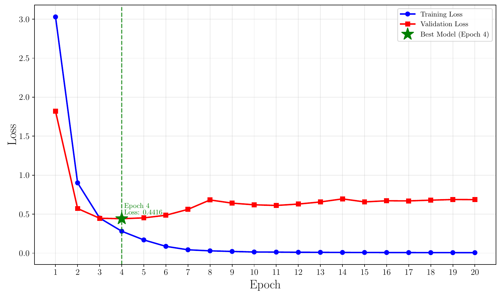 | 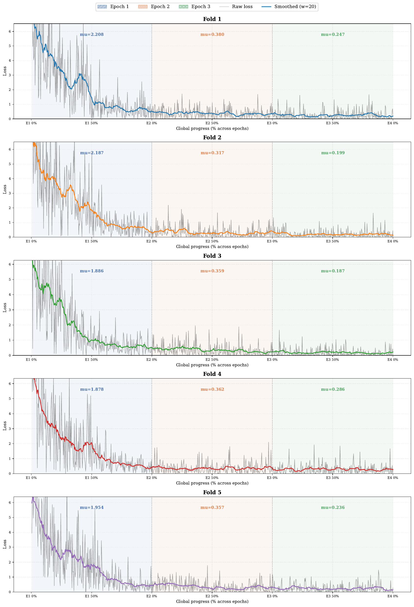 |
| **(a)** Training and Validation loss over 20 epochs for Llama 3. The green marker indicates the optimal model checkpoint at epoch 4. Longer training durations result in poorer generalisation performance. | **(b)** Training loss over three epochs for Mistral, shown across five folds. |

---

## 9. Reproducibility

Every figure in this document and in the main paper is regenerated from the stored model predictions by a single notebook, so no figure depends on manual steps or on the order in which cells were executed. The notebook also emits the tables it reports, and validates that all four models are scored against the same ground truth for the same article. Anyone can therefore re-derive the error and bias figures behind the paper's claims about responsible use, instead of relying on the printed versions.

Fine-tuned model weights and code are withheld during review to preserve anonymity and will be released upon acceptance.
